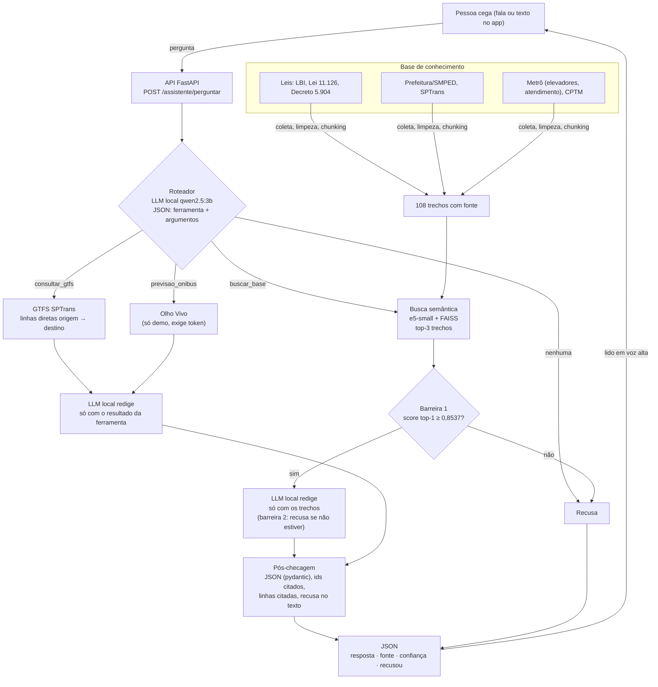

# Relatório técnico: Sonar, assistente de mobilidade acessível

**Disciplina:** Generative AI for Engineering, FIAP (Global Solution, componente de Inteligência)
**Repositório:** https://github.com/gtorresluiz/GS_Sonar_SpeechAgent

---

## 1. Integrantes

| Nome | RM |
|---|---|
| Gabriel Torres Luiz | RM 98600 |
| Eduardo Fedeli Souza | RM 550132 |
| Otavio Vitoriano da Silva | RM 552012 |
| Rodrigo Resende Viana | RM 551057 |
| Caíque Chagas Nitta | RM 551943 |

---

## 2. Ficha Técnica

| Item | Descrição |
|---|---|
| **Problema** | Uma pessoa cega no transporte público de São Paulo não tem como consultar, com segurança, informações de acessibilidade e de trajeto: se a estação tem elevador, quais são os seus direitos com o cão-guia, qual linha a leva ao destino. Uma resposta inventada pode levá-la a uma estação sem acesso. |
| **Tarefa da IA** | Assistente de mobilidade acessível (área: **mobilidade**). Recebe a pergunta em linguagem natural (texto, ou fala transcrita no app) e responde **em JSON com resposta, fonte e confiança**, recusando quando a informação não está na base. |
| **Usuário** | Pessoa com deficiência visual. A resposta é lida em voz alta, então o que conta é o **texto** da resposta (é o que motiva a métrica estrita de recusa, na seção 5). |
| **Formato de saída** | `{"resposta": str, "fonte": [ids], "confianca": 0–1, "recusou": bool}`, validado com pydantic. A API acrescenta `ferramenta` e `config`. |
| **LLM** | `qwen2.5:3b` (3B parâmetros), **local**, via Ollama. Temperatura 0, seed 42, `num_ctx` 4096, saída restrita por JSON schema. Pode ser trocado pela variável `SONAR_MODELO`. |
| **Embedding e índice** | `intfloat/multilingual-e5-small` (vetores normalizados) + `faiss.IndexFlatIP` sobre 108 trechos. |
| **Base de conhecimento** | 9 fontes públicas (leis federais, Prefeitura/SMPED, SPTrans, Metrô, CPTM), com 108 trechos com fonte e licença, mais o GTFS da SPTrans como ferramenta (seção 4). |
| **Configurações comparadas** | (1) LLM sem contexto; (2) RAG simples (top-3, duas barreiras de recusa); (3) agente com ferramentas. O agente corrigido (`agente_v2`) aparece separado, como resultado das correções. |
| **Ferramentas do agente** | `buscar_base` (o RAG), `consultar_gtfs` (linhas diretas entre dois locais, determinística) e `previsao_onibus` (API Olho Vivo, só demo, fica fora da avaliação). |
| **Recusa** | Barreira 1: pré-filtro por score da busca (limiar 0,8537). Barreira 2: o LLM recusa se a resposta não estiver nos trechos. No `agente_v2` entram mais duas: citação inválida vira recusa, e `recusou=true` força a frase de recusa. |
| **Integração** | API FastAPI: `POST /assistente/perguntar` (padrão `agente_v2`) e `GET /saude`. |
| **LGPD** | A API não recebe identificador de usuário, não guarda histórico e não persiste áudio. O log guarda só a configuração, a ferramenta e a latência. O LLM é local, então nenhum dado sai da máquina. A base é feita só de documentos públicos, sem dados pessoais. |
| **Avaliação** | 63 casos de teste com gabarito (30 `texto`, 18 `rota`, 15 `nao_consta`) e 12 casos de validação, escritos à parte depois da análise de erros. |
| **Execução** | Local, sem nuvem. A reprodução está no [README](README.md). |

---

## 3. Diagrama do pipeline de IA

**Documentos e etapas** (um notebook por etapa): coleta e chunking (01), busca e limiar (02), config 1 (03), config 2 (04), config 3 (05), e placar com erros e correções (06).

---

## 4. Tabela da base de conhecimento

| ID | Fonte | Formato | Licença / termos | Nº de trechos |
|---|---|---|---|---|
| `lbi` | Lei 13.146/2015, Lei Brasileira de Inclusão (arts. 46 a 52, transporte) | HTML (Planalto) | Texto legal, sem proteção autoral (Lei 9.610/98, art. 8º, IV) | 7 |
| `lei_caoguia` | Lei 11.126/2005 (cão-guia) | HTML (Planalto) | Texto legal, sem proteção autoral | 4 |
| `dec_caoguia` | Decreto 5.904/2006 (regulamenta a Lei 11.126) | HTML (Planalto) | Texto legal, sem proteção autoral | 9 |
| `smped_guia` | SMPED/Prefeitura de SP, Guia de Serviços: Transporte e Mobilidade | HTML | Conteúdo público institucional, com citação da fonte | 4 |
| `sptrans_manual` | SPTrans, manual de atendimento a pessoas com deficiência | PDF | Material público da SPTrans, com citação da fonte | 15 |
| `sptrans_pcd` | SPTrans, página de serviços para pessoas com deficiência | HTML | Conteúdo público institucional, com citação da fonte | 1 |
| `metro_elev` | Metrô SP, formas de acesso às estações e plataformas (tabela) | PDF | Conteúdo público institucional, com citação da fonte | 66 |
| `metro_pref` | Metrô SP, Atendimento Preferencial | HTML | Conteúdo público institucional, com citação da fonte | 1 |
| `cptm_acess` | CPTM, página de acessibilidade | HTML | Conteúdo público institucional, com citação da fonte | 1 |
| **Total** | | | | **108** |
| `gtfs_sptrans` | GTFS SPTrans, versão de 12/11/2026 (1.366 linhas, 22.266 paradas) | CSV | Termos de uso do portal de desenvolvedores da SPTrans | ferramenta (não vira trecho) |

As URLs, a data de coleta e as observações estão em [`base/fontes.md`](base/fontes.md), e os originais em `base/brutos/`. Algumas decisões de coleta:
- **Tamanho dos trechos:** cada artigo de lei vira um trecho; as páginas, trechos de 250 a 380 palavras com 40 de sobreposição.
- **Tabela de elevadores do Metrô:** foi extraída como tabela (pdfplumber), com uma frase por local e **um trecho por estação e linha**.
- **Fonte descartada:** o Guia do Passageiro do Metrô (`metro_guia`) retornava 404 e não tinha cópia no Wayback em 16/11/2026. Por isso a base não tem fonte para piso tátil e acompanhamento no Metrô.
- **Cobertura:** as linhas concessionadas (4, 5, 8 e 9) estão fora das fontes do Metrô e da CPTM, então perguntas sobre elas são `nao_consta` nos testes.

---

## 5. Performance

### 5.1 Casos de teste
`avaliacao/casos_teste.jsonl`: 63 casos com gabarito, gerados por `avaliacao/gerar_casos.py`. As perguntas foram escritas como uma pessoa cega falaria a um assistente de voz (coloquiais, às vezes sem acento).

| Tipo | Casos | Gabarito |
|---|---|---|
| `texto` | 30 | resposta, palavras-chave obrigatórias e ids dos trechos que contêm a resposta (conferidos no texto) |
| `rota` | 18 | `linhas_esperadas` **verificadas à mão** (route_long_name + sequência de paradas) e `linhas_incorretas` (falsos positivos conhecidos da ferramenta, que penalizam) |
| `nao_consta` | 15 | "Não consta na base de conhecimento.", com pegadinhas: estações de linhas concessionadas, dados em tempo real, assunto existente na base com o detalhe perguntado ausente |

O gabarito de rota **não** vem da ferramenta: na primeira versão vinha, e 8 dos 15 casos herdaram falsos positivos (o placar ficaria circular).

### 5.2 Busca (recall e limiar)
| Métrica (30 casos `texto`) | Valor |
|---|---|
| recall@1 | **0,767** |
| recall@3 | **0,967** |
| recall@1 nos 8 casos de elevador | 1,000 |

**Limiar justificado: 0,8537.** Os scores do top-1 ficam todos numa faixa estreita (0,82 a 0,92). Os casos `texto` vão de 0,852 a 0,921, e os `nao_consta`, de 0,822 a 0,877. Escolher pelo F1 máximo (limiar 0,8739) recusaria 7 das 30 perguntas respondíveis, o que deixaria o assistente pouco útil. Por isso o limiar funciona como **pré-filtro**, e o critério é o **maior limiar com no máximo 1 falsa recusa em 30**. A segunda barreira (o LLM recusar quando a resposta não está nos trechos) cuida das quase-respostas.

| Critério | Limiar | Falsa recusa (texto) | Recusa correta (nao_consta) |
|---|---|---|---|
| pré-filtro (escolhido) | 0,8537 | 1/30 | 6/15 |
| leave-one-out (estimativa sem sobreajuste) | 0,8537 a 0,8577 | 2/30 | 6/15 |
| F1 máximo (só para comparação) | 0,8739 | 7/30 | 13/15 |

**Experimento de chunking.** A hipótese era que agrupar cerca de 15 estações por trecho diluía o embedding. Trocamos por um trecho por estação: o recall não mudou (0,767 e 0,967) e a pegadinha "Faria Lima" (Linha 4, fora da base) subiu de 0,867 para 0,873. A hipótese foi refutada, porque o e5-small dá mais peso ao tema ("estação + elevador") do que ao nome próprio. Mantivemos um trecho por estação pela **citação**: o LLM recebe só a estação perguntada. Detalhes no notebook 02 e em `avaliacao/busca.json`.

### 5.3 Placar das três configurações (63 casos, métrica estrita)

**Métrica estrita de recusa:** uma recusa só conta se `recusou=true` **e** o texto da resposta é uma recusa, porque o app lê o texto em voz alta. Pela métrica antiga, um caso como o `nao_consta_12` (marcava `recusou=true` e respondia como conseguir um cão-guia) contava como recusa correta.

| Config | Acerto | Alucinação | Recusa correta | Falsa recusa | JSON válido | Citação correta | Latência |
|---|---|---|---|---|---|---|---|
| 1 LLM sem contexto | 0,238 | **0,762** | 0,067 | 0,000 | 1,00 | 0,00 | 0,74 s |
| 2 RAG simples | 0,651 | **0,111** | 0,867 | 0,349 | 1,00 | 0,80 | 2,87 s |
| 3 Agente com ferramentas | **0,746** | 0,159 | 0,867 | 0,140 | 1,00 | 0,67 | 1,87 s |

| Acerto por tipo | Sem contexto | RAG | Agente |
|---|---|---|---|
| texto (30) | 0,367 | **0,767** | 0,667 |
| rota (18) | 0,167 | 0,278 (não tem GTFS) | **0,778** |
| nao_consta (15) | 0,067 | 0,867 | 0,867 |

Gráficos: `avaliacao/placar.png` (placar) e `avaliacao/roteador.png` (tipo × ferramenta escolhida). O roteador acerta 56 de 63 (0,889).

**Interpretação.**
- **Sem contexto, o modelo alucina em 3 de cada 4 casos.** Ele responde quase tudo com confiança, inclusive 14 dos 15 `nao_consta`. Por exemplo, afirma "Não há elevador na estação Adolfo Pinheiro" com confiança 1,0. Os acertos vêm de conhecimento geral ou de coincidência de palavra-chave, então até o 0,238 é otimista. No apêndice, a config 1b (mesmo modelo, **com** instrução de recusa) mostra que só mandar o modelo recusar não resolve: a alucinação cai para 0,270, mas ele recusa 40% do que tinha resposta.
- **O RAG é a configuração mais segura** (alucinação de 11,1%) e a melhor em `texto` (0,767), com a fonte certa em 80% dos casos. As duas barreiras se complementam: o pré-filtro barrou 6 dos 15 `nao_consta` e o LLM, mais 7. O RAG perde em rota (não tem o GTFS, então recusa as 13 rotas com linha) e em latência (o prompt carrega 3 trechos).
- **O agente ganha em cobertura e paga em alucinação.** É o melhor acerto geral (0,746) e o único que responde rota (0,778 contra 0,278). Mas a alucinação sobe para 15,9%, porque **o agente herda a confiança da ferramenta**: quando o `consultar_gtfs` devolve uma linha errada, o LLM a redige com confiança alta, e a pós-checagem não pega, já que a linha veio da ferramenta. O RAG recusa essas mesmas rotas. O agente responde errado com confiança. Em `texto`, ele perde 3 casos para o RAG, todos por roteamento.
- **Empate:** JSON válido em 100% nas três configurações, graças à saída restrita por schema e à validação com pydantic.

**Cuidados.** Um caso vale 1,6 ponto percentual. Repetindo a execução, o Ollama varia cerca de 1 caso, mesmo com temperatura 0 e seed 42. O acerto por palavra-chave pode ser generoso (config 1) ou conservador (quando o agente não cita o código da linha).

### 5.4 Depois das correções (`agente_v2`) e validação
As correções foram propostas a partir dos erros da seção 6 e medidas sem alterar o agente original nem o gabarito.

| | Agente | Agente_v2 (C1, C1b, C2, C3, C4) |
|---|---|---|
| acerto | 0,746 | **0,841** |
| alucinação | 0,159 | **0,111** |
| recusa correta | 0,867 | 1,000 |
| falsa recusa | 0,140 | 0,070 |
| citação correta | 0,667 | 0,800 |
| latência | 1,87 s | 3,60 s |

O saldo é de +6 casos (47 → 53): 8 passaram a acertar e 2 passaram a errar (`texto_16`, por ruído do LLM, e `rota_07`, efeito colateral da C1b).

**A melhora é otimista**, porque as correções foram desenhadas olhando esses mesmos 63 casos. Para medir isso, escrevemos 12 casos de **validação** à parte (`avaliacao/casos_validacao.jsonl`). Neles, o agente e o agente_v2 **empatam**: acerto 0,667 e alucinação 0,250. As correções resolvem os padrões que atacaram, e nenhum desses padrões aparece na validação. A validação, por sua vez, revela **erros de tipos novos**: troca de origem e destino na extração, resposta parcial (omite a rampa) e resposta sem o código da linha. Com 12 casos (um caso vale 8 pontos percentuais), ela não prova que as correções deixam de generalizar, mas também não confirma o ganho.

---

## 6. Os 5 erros reais, causa e correção

As saídas abaixo são reais, copiadas de `avaliacao/resultados/*.jsonl`. A pergunta completa, a saída, o esperado e os scores de cada caso estão em [`avaliacao/erros.md`](avaliacao/erros.md). Escolhemos um erro por camada do pipeline.

| # | Camada | Caso | O que aconteceu | Causa | Correção proposta | Medida? |
|---|---|---|---|---|---|---|
| 1 | Busca | `texto_19` "em que braço devo segurar?" | O trecho certo ficou fora do top-3, e o LLM inventou "segure no braço do guia" | Vocabulário diferente ("ser guiado" × "acompanhe… oferecendo o braço oposto à bengala"), que o e5-small não aproxima | Embedding maior (e5-base, bge-m3), expansão de consulta ou busca híbrida (BM25 + embedding) | Não corrigido |
| 2 | Geração / citação | `nao_consta_01` "a Faria Lima (Linha 4) tem elevador?" | Passou do pré-filtro (0,873), respondeu "Sim" usando a estação Luz e **inventou o id** `metro_elev_l3-vermelha_lima` | O embedding recupera qualquer "estação + elevador", e o LLM de 3B responde como se fosse a estação pedida | **C2:** citação inválida vira recusa; checar se o nome da estação perguntada aparece no trecho | **Corrigido** |
| 3 | Geração / leitura | `texto_30` "uma pessoa cega pode usar o Táxi Acessível da CPTM?" | Respondeu "Sim" com confiança 1,0, citando o trecho certo, que diz "**exclusivo** para deficiência físico-motora" | O modelo de 3B não compara o público do serviço com o da pergunta | Modelo maior (`qwen2.5:7b-instruct`) e regra no prompt: "antes de dizer sim, confira para quem o serviço é destinado" | Não corrigido |
| 4 | Ferramenta | `rota_04` Brás → Tatuapé; `rota_12` Sto. Amaro → Lapa | Sugeriu ônibus que não fazem o trajeto (embarque na "Av. Brás de Abreu", zona sul) | O `consultar_gtfs` casava o nome também em `stop_desc` e em paradas espalhadas pela cidade, e o agente confia na ferramenta | **C1/C1b:** casar só `stop_name`, agrupar paradas por proximidade, priorizar terminal ou estação e normalizar abreviações (Sto., Jd.) | **Corrigido** (com regressão no `rota_07`, documentada) |
| 5 | Roteamento | `texto_23`, `25`, `29`, `rota_06` | O roteador escolheu "nenhuma" para perguntas respondíveis, que viraram falsa recusa | Roteador de 3B com só 6 exemplos trata perguntas curtas de número ou cadastro como fora do tema | **C3:** se o roteador escolher "nenhuma" mas a busca passar do limiar, usar `buscar_base` | **Corrigido** em 3 de 4 (o `rota_06` cai no RAG, que não tem o GTFS) |

**Erros extras documentados em `erros.md`:**
- `rota_10`: extração troca "Terminal Bandeira" por "Terminal Bandeirantes".
- `nao_consta_12`: `recusou=true` com resposta inventada; corrigido pela **C4**.
- `rota_07`: regressão da C1b.
- Os erros novos da validação.
- Problemas encontrados na própria base: acentos em NFD, parágrafo duplicado e a fonte descartada por 404.

---

## 7. Conclusão técnica

1. **A fundamentação é o que reduz a alucinação. A instrução sozinha não basta.** O mesmo modelo de 3B passa de 76,2% de alucinação (sem contexto) para 11,1% com RAG. Só pedir para recusar (config 1b) transforma o modelo em um assistente que recusa 40% do que sabe.
2. **A recusa precisa de mais de uma barreira.** Com o e5-small, os scores de perguntas respondíveis e não respondíveis se sobrepõem (0,82 a 0,92). Nenhum limiar separa os dois grupos sem recusar perguntas boas. O desenho que funcionou foi um pré-filtro conservador, o LLM instruído a recusar e pós-checagens determinísticas (citação, linha e texto da recusa).
3. **A especialização com ferramentas ganha cobertura, mas transfere a confiança para a ferramenta.** O agente foi a única configuração que respondeu rotas, mas um GTFS mal casado virou resposta errada com confiança 1,0. Ferramenta determinística não é o mesmo que ferramenta correta. Ela precisa de testes e de verificação da própria saída.
4. **Medir a métrica certa muda a conclusão.** Contar o campo `recusou` em vez do texto que a pessoa ouve escondia uma alucinação. O gabarito de rota tirado da própria ferramenta escondia 8 erros. As duas correções vieram de perguntar "o que o usuário realmente recebe?".
5. **Limites.** Usamos um único modelo pequeno (3B), uma base pequena (108 trechos), o acerto medido por palavra-chave, uma variação de cerca de 1 caso entre execuções e uma validação de só 12 casos. A ferramenta de rotas encontra só linhas diretas, sem baldeação.
6. **Próximos passos.** Busca híbrida (BM25 + embedding) para nomes próprios; testar o `qwen2.5:7b-instruct`; aceitar rotas com baldeação; verificar o nome extraído contra o GTFS; e ampliar a validação.

---

## 8. Links

- **Repositório:** https://github.com/gtorresluiz/GS_Sonar_SpeechAgent
- **Vídeo de demonstração:** https://www.youtube.com/watch?v=buBn3XlFTOo
- **Placar completo:** [`avaliacao/placar.md`](avaliacao/placar.md)
- **Erros e correções:** [`avaliacao/erros.md`](avaliacao/erros.md)
- **Fontes:** [`base/fontes.md`](base/fontes.md)
